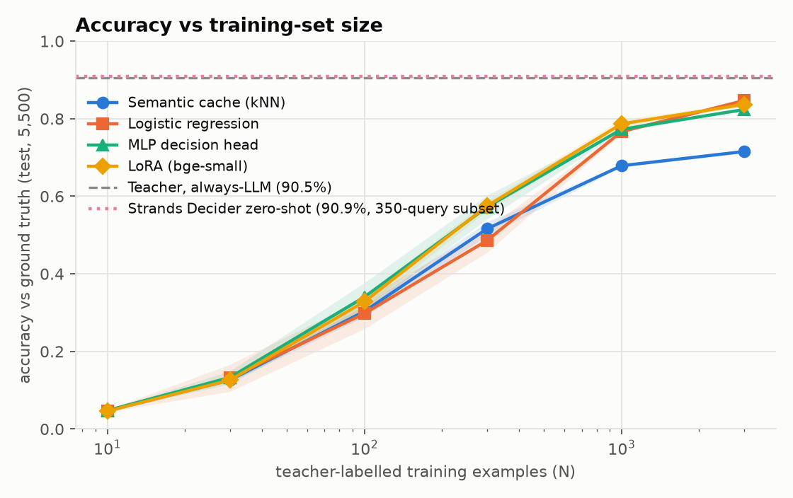
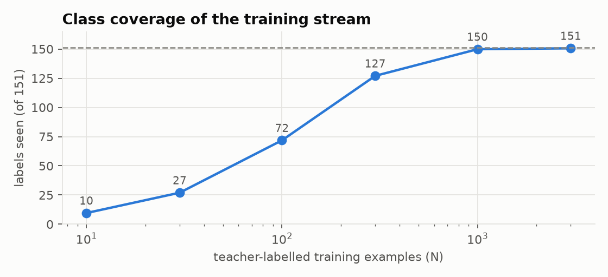
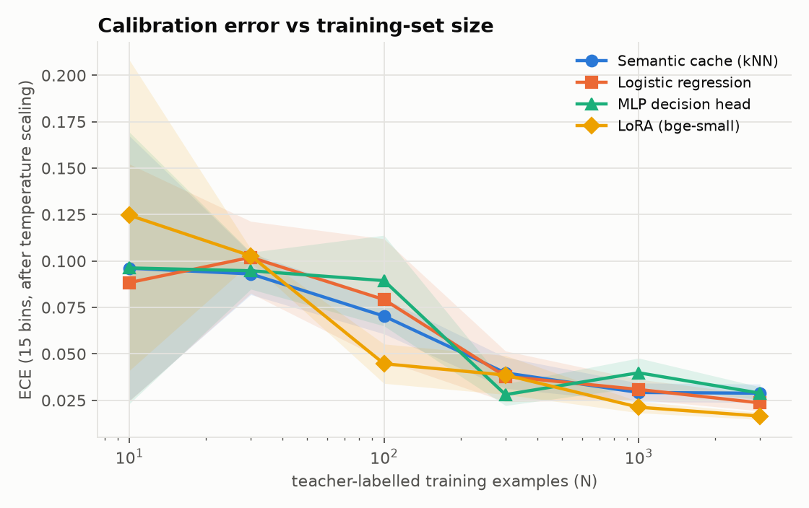
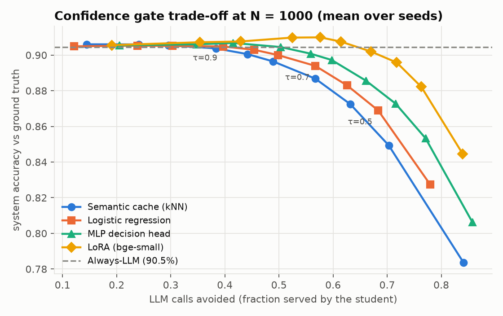
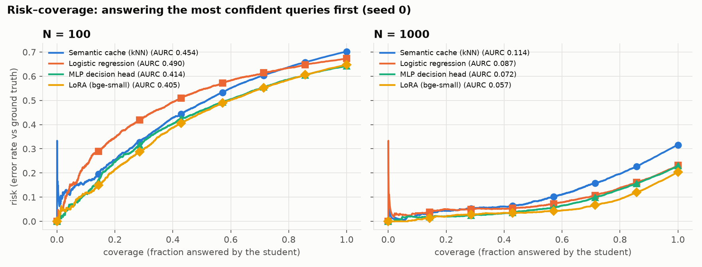
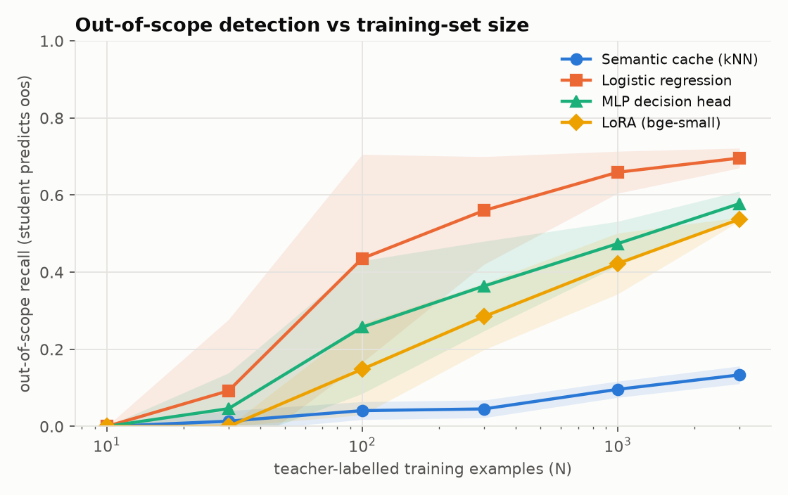
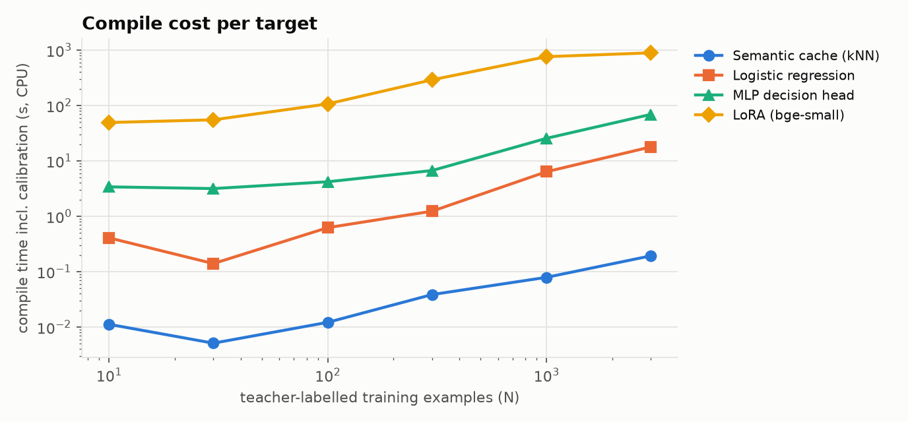
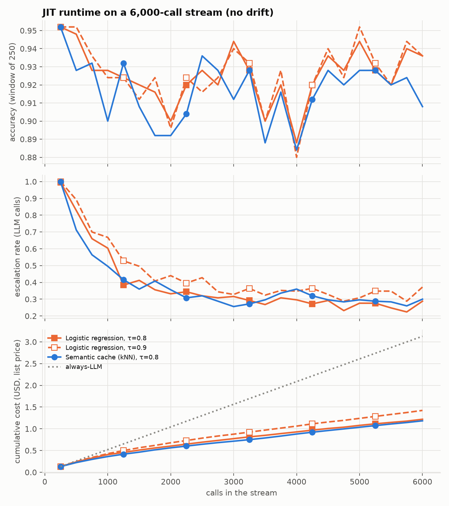

# Overnight report: JIT AI compilation on CLINC150

*Written overnight from 2026-11-23 to 11-24 by Claude while Zihan was away. Everything below was run on this machine, and every number comes from files in `runs/`. Nothing is committed (there is no git repo yet).*

## TL;DR

- **The teacher labelled all 23,845 CLINC150 queries** (DeepSeek-V4.1-Flash economy on Volcengine), with 0 failed calls.
  - Accuracy against ground truth is **90.5% on test**: 90.4% in-scope; out-of-scope recall 90.5%, out-of-scope precision 83.0%.
  - Every query is in the cache, so the experiments below cost nothing to rerun.
  - The run used 51.5M input and 0.9M output tokens, which is **$12.17 at list price**. Your plan is a flat monthly subscription, so the real cost was AFP quota.
- **Compile-target ladder** (5 seeds; LoRA 3 seeds), evaluated on all 5,500 test queries against ground truth:
  - **Small N is limited by label coverage, not by the model.** N=10 covers only 10 of 151 labels, so every target is about 5% accurate.
  - **Among the fast targets, the MLP head is best from N=100 to 1,000**: 34% at N=100, 57% at N=300, 77% at N=1,000.
  - **Logistic regression is best at N=3,000**: 84.7%.
  - **The semantic cache plateaus** at about 72%.
  - **The exact cache is useless** on held-out queries, which never repeat.
  - **LoRA is the most accurate from N=300 to 1,000** (57.5%, 78.7%) and close at 3,000 (83.7% vs 84.7% for logistic regression). It is also the best calibrated from N=100 (ECE 0.017–0.045), so its gate avoids the most LLM calls. The price is compile time: 13–15 minutes on this CPU at N≥1,000, against 11–29 s for logistic regression.
- **Calibration works after one fix.** With temperature scaling fitted on all out-of-fold examples (see [Calibration](#calibration-a-finding)), ECE is ≤ 0.10 at every N and ≤ 0.04 from N=300. Standard NLL temperature scaling gave ECE ≈ 0.3 at N=100.
- **The confidence gate pays off from about N=300.** The threshold τ is chosen on the val split, reweighted to the 18% out-of-scope share of real traffic, and then scored on test. Mean system accuracy stays within about 0.5 points of always-LLM while it avoids:
  - 21% of LLM calls at N=300 (kNN or MLP; 28% with LoRA)
  - 46–56% at N=1,000 (logistic regression or MLP; 64% with LoRA)
  - **68–73% at N=3,000** (MLP or logistic regression; 76% with LoRA)
  - Single seeds still slip past 0.5 points (up to 3 of 5 at N=3,000). Choosing τ on val *as is* (only 3% out of scope) overshoots: test accuracy falls 1.2–1.9 points at N=3,000. An earlier draft picked τ on test; that version is kept below as an upper bound.
- **End-to-end runtime on a 6,000-call stream:**
  - Logistic regression at τ=0.8 reached **92.6% accuracy**, against 92.2% for always-LLM.
  - It made **38% of the LLM calls** and cost **$1.22 instead of $3.13**.
  - The break-even point is **N\* ≈ 290 calls**. Compile time is charged in that cost.
- **Zero-shot Strands Decider is a very strong baseline.**
  - On a 350-query stratified test subset it scored **90.9%**. The LLM teacher scored 89.4% on the same queries.
  - It is well calibrated (ECE 0.054), and at τ=0.8 it answers 71% of queries itself with 98.4% accuracy.
  - The catch is speed: **about 12 s per query on this CPU**. The model README quotes about 62 ms on an H100.
  - This changes the story of the project; see [Discussion](#discussion-and-suggested-next-steps).

## What was built (all in `code/jit/`)

| File | What it does |
|---|---|
| `data.py` | Loads CLINC150 (plus variant) and defines the closed 151-member `Intent` type |
| `teacher.py` | The teacher `@ai_function`, with two backends selected by `JIT_TEACHER`: `volc` (DeepSeek, the default) or `bedrock` (Haiku 4.5) |
| `teacher_cache.py` | SQLite response cache plus a JSONL call log (query, label, model, prompt hash, cache hit, latency, tokens, cost, attempts, error) |
| `label_pool.py` | Labels whole splits through the cache, with concurrency and retries |
| `sanity.py` | Teacher-vs-ground-truth check on a stratified val sample (step 6) |
| `embed.py` | Embeds every query once with bge-small-en-v1.5 (CPU, 42 s) and caches the vectors |
| `students.py` | Compile targets (exact cache, semantic cache, logistic regression, MLP head) and `Calibrated` temperature scaling |
| `lora.py` | LoRA target: rank-8 adapters on bge-small's attention plus a prototype-initialised cosine head, trained on CPU |
| `metrics.py` | Accuracy, ECE, risk–coverage/AURC, the gate, gated system metrics |
| `runtime.py` | **`JITFunction`**, the runtime: exact store → student if confident → else teacher (label stored) → recompile every k labels. Also `TeacherTable`, a free cache-only teacher for simulations |
| `ladder.py` | The compile-target ladder experiment |
| `stream_demo.py` | The runtime on a time-ordered stream, with cost accounting and N\* |
| `decider_baseline.py` | Zero-shot Strands Decider (v2 E2B, CPU) |
| `analyze.py`, `plots.py` | Tables (`runs/tables.md`) and figures (`figures/*.png`) |

The code had no test suite beyond these runnable checks; the smoke tests are each module's `__main__`.

## Setup details

- **Teacher:**
  - Model `deepseek-v4-1-flash-economy` at `https://ark.cn-beijing.volces.com/api/plan/v3`, with thinking disabled and temperature 0.
  - The prompt is the full label catalogue grouped by domain (about 2,160 input tokens) and the output is a typed `Intent`.
  - Median latency is about 2.1 s per call. Throughput with 12 concurrent calls was about 4.8 queries/s, with occasional rate limits that the client retries absorbed.
- **Prices:**
  - List price ¥1.6 / ¥6.4 per million input/output tokens (peak period), converted at 7.1 CNY/USD, which is about $0.00052 per call.
  - This is a hypothetical pay-per-token price. Your plan is flat, so cost comparisons use list price.
- **Training stream for the ladder:** the train split in a seeded random order. The first N queries, with *teacher* labels (never ground truth), train each target.
- **Evaluation:** the full test split (5,500 queries, 1,000 of them out of scope), scored against *ground truth*. Teacher agreement is also logged (`agree_teacher`).
- **Gated metrics:** the student answers if its calibrated confidence ≥ τ and it did not predict `oos`; otherwise the teacher's cached label is used.
- **Hardware:** i9-14900F CPU (no GPU), 32 GB RAM.
  - Compile times were measured while other jobs (the Decider, LoRA) shared the CPU, so treat them as rough.

## Results

### Accuracy vs training-set size



| N | labels seen | Exact cache | Semantic cache (kNN) | Logistic regression | MLP head | LoRA |
|---|---|---|---|---|---|---|
| 10 | 10 / 151 | 0.5% ± 0.0% | 4.7% ± 0.2% | 4.7% ± 0.3% | **4.8% ± 0.2%** | 4.6% ± 0.2% |
| 30 | 27 / 151 | 0.5% ± 0.0% | 12.6% ± 0.6% | 13.2% ± 3.5% | **13.3% ± 1.7%** | 12.6% ± 0.2% |
| 100 | 72 / 151 | 0.5% ± 0.0% | 30.3% ± 1.4% | 29.8% ± 3.9% | **34.0% ± 3.7%** | 32.8% ± 1.7% |
| 300 | 127 / 151 | 0.5% ± 0.0% | 51.6% ± 1.8% | 48.6% ± 3.1% | 57.2% ± 3.1% | **57.5% ± 1.2%** |
| 1000 | 150 / 151 | 0.5% ± 0.0% | 67.9% ± 0.4% | 76.7% ± 0.4% | 77.3% ± 0.6% | **78.7% ± 1.2%** |
| 3000 | 151 / 151 | 0.5% ± 0.0% | 71.5% ± 0.4% | **84.7% ± 0.3%** | 82.4% ± 0.3% | 83.7% ± 0.3% |

How to read the table:
- **Class coverage dominates up to N≈300.** The "labels seen" column is the ceiling.
  - At N=100, only 72 of the 151 labels have appeared, so queries for the other labels are always wrong.
  - All targets track each other closely until the labels are mostly covered (N≈300–1,000). Only after that does the choice of model matter.
- **LoRA and the MLP head win in the middle range** (100–1,000); LoRA leads from N=300.
- **Logistic regression wins at 3,000.** At that size it is also faster to compile than the MLP.
- **kNN saturates.** One nearest-neighbour similarity per class cannot separate confusable intents (`distance`/`directions`, `reminder`/`reminder_update`).



### Calibration (a finding)



The first ladder run used standard temperature scaling: NLL fitted on cross-validated logits. Its partial results are kept in `runs/ladder_nll_partial.jsonl`.

- **The problem:** an out-of-fold example whose label never appeared in that fold's training data has probability 0 under the student. NLL cannot score it, so it has to be dropped.
- **The effect:** the temperature is then fitted only on "known-label" queries. The deployed student meets many unknown labels, so at N=100 it came out badly overconfident (ECE about 0.30 for kNN, logistic regression and the MLP alike).
- **The fix:** keep the single temperature, but fit it by binary cross-entropy of top-label confidence against "was the answer correct", over *all* out-of-fold examples. This is exactly the quantity the gate thresholds.
- **The result:** ECE fell to 0.07–0.10 at N≤100 and 0.02–0.04 at N≥300. At small N the confidence drops low enough that the gate correctly refuses to serve.
- Code: `fit_temperature(objective="top_bce")` in `students.py`.

| N | Exact cache | Semantic cache (kNN) | Logistic regression | MLP head | LoRA |
|---|---|---|---|---|---|
| 10 | 0.001 | 0.096 | 0.088 | 0.096 | 0.125 |
| 30 | 0.001 | 0.093 | 0.102 | 0.095 | 0.103 |
| 100 | 0.001 | 0.070 | 0.079 | 0.089 | 0.045 |
| 300 | 0.001 | 0.040 | 0.038 | 0.028 | 0.039 |
| 1000 | 0.001 | 0.029 | 0.031 | 0.040 | 0.021 |
| 3000 | 0.001 | 0.029 | 0.024 | 0.029 | 0.017 |

### Confidence gate: how many LLM calls can be avoided?



How the threshold is chosen matters as much as the target.

- **Procedure.** For each target, seed and N, τ is the threshold with the most val coverage whose val system accuracy is within 0.5 points of the teacher's val accuracy. Test is then scored at that τ. Val is never used for training or calibration.
- **The out-of-scope mismatch.** Val is only 3% out of scope (100 of 3,100), while test is 18% (1,000 of 5,500). Students are weakest on out-of-scope queries, so val alone makes aggressive thresholds look safe.
- **The fix is to reweight.** Score val as if 18% of it were out of scope (the deployment's expected share), using its in-scope and out-of-scope halves separately. With that, mean test accuracy stays within about 0.5 points of always-LLM for every target and N except logistic regression at N=3,000 (−0.6).
- **Seed-level noise remains.** On 3,100 val queries, 0.5 points is about 15 queries, so individual seeds miss by up to about 1 point.
- **Typical thresholds chosen.** 0.85–0.9 at N=300; 0.7–0.9 at N=1,000; and 0.5–0.8 at N=3,000, except kNN, which needs 0.85–0.95 throughout.

#### τ chosen on val, reweighted to 18% out of scope (recommended)

Per seed, τ is the threshold with the most val coverage whose val system accuracy stays within 0.5 points of the teacher's val accuracy; if none qualifies, always escalate. Cells: test LLM calls avoided / test system accuracy minus always-LLM, in points / seeds whose test drop exceeds 0.5 points.

| N | Exact cache | Semantic cache (kNN) | Logistic regression | MLP head | LoRA | best target (mean drop ≤ 0.5) |
|---|---|---|---|---|---|---|
| 10 | 0% / +0.0 / 0 of 5 | 0% / -0.1 / 0 of 5 | 0% / +0.0 / 0 of 5 | 0% / -0.0 / 0 of 5 | 1% / -0.0 / 0 of 3 | LoRA |
| 30 | 0% / +0.0 / 0 of 5 | 3% / -0.2 / 0 of 5 | 1% / -0.1 / 0 of 5 | 2% / -0.1 / 0 of 5 | 3% / -0.2 / 0 of 3 | LoRA |
| 100 | 0% / +0.0 / 0 of 5 | 8% / -0.3 / 2 of 5 | 4% / -0.4 / 1 of 5 | 7% / -0.3 / 0 of 5 | 10% / -0.2 / 0 of 3 | LoRA |
| 300 | 0% / +0.0 / 0 of 5 | 21% / -0.2 / 1 of 5 | 13% / -0.3 / 0 of 5 | 21% / -0.3 / 2 of 5 | 28% / -0.3 / 1 of 3 | LoRA |
| 1000 | 0% / +0.0 / 0 of 5 | 38% / -0.1 / 0 of 5 | 46% / -0.2 / 0 of 5 | 56% / -0.5 / 2 of 5 | 64% / +0.1 / 1 of 3 | LoRA |
| 3000 | 0% / +0.0 / 0 of 5 | 42% / +0.1 / 0 of 5 | 73% / -0.6 / 3 of 5 | 68% / -0.4 / 2 of 5 | 76% / -0.3 / 1 of 3 | LoRA |

#### τ chosen on val as is (3% out of scope)

Per seed, τ is the threshold with the most val coverage whose val system accuracy stays within 0.5 points of the teacher's val accuracy; if none qualifies, always escalate. Cells: test LLM calls avoided / test system accuracy minus always-LLM, in points / seeds whose test drop exceeds 0.5 points.

| N | Exact cache | Semantic cache (kNN) | Logistic regression | MLP head | LoRA | best target (mean drop ≤ 0.5) |
|---|---|---|---|---|---|---|
| 10 | 0% / +0.0 / 0 of 5 | 0% / -0.1 / 0 of 5 | 0% / +0.0 / 0 of 5 | 0% / -0.0 / 0 of 5 | 1% / -0.0 / 0 of 3 | LoRA |
| 30 | 0% / +0.0 / 0 of 5 | 3% / -0.1 / 0 of 5 | 1% / -0.1 / 0 of 5 | 2% / -0.1 / 0 of 5 | 3% / -0.2 / 0 of 3 | LoRA |
| 100 | 0% / +0.0 / 0 of 5 | 7% / -0.2 / 1 of 5 | 3% / -0.2 / 0 of 5 | 7% / -0.3 / 0 of 5 | 10% / -0.2 / 0 of 3 | LoRA |
| 300 | 0% / +0.0 / 0 of 5 | 21% / -0.3 / 1 of 5 | 13% / -0.3 / 0 of 5 | 21% / -0.3 / 2 of 5 | 26% / -0.1 / 0 of 3 | LoRA |
| 1000 | 0% / +0.0 / 0 of 5 | 43% / -0.4 / 1 of 5 | 46% / -0.2 / 0 of 5 | 62% / -1.2 / 5 of 5 | 67% / -0.3 / 1 of 3 | LoRA |
| 3000 | 0% / +0.0 / 0 of 5 | 53% / -0.4 / 1 of 5 | 76% / -1.2 / 5 of 5 | 75% / -1.9 / 5 of 5 | 81% / -1.9 / 3 of 3 | Semantic cache (kNN) |

#### Oracle: τ chosen on test (upper bound, as in the first draft)

Upper bound only: τ is picked per (target, N) by looking at test results. The val-chosen tables below are the honest numbers.

| N | Exact cache | Semantic cache (kNN) | Logistic regression | MLP head | LoRA | best target |
|---|---|---|---|---|---|---|
| 10 | 0% | 1% (τ=0.6) | 0% | 1% (τ=0.6) | 1% (τ=0.6) | LoRA |
| 30 | 0% | 2% (τ=0.5) | 1% (τ=0.6) | 2% (τ=0.5) | 3% (τ=0.6) | LoRA |
| 100 | 0% | 8% (τ=0.7) | 3% (τ=0.8) | 5% (τ=0.8) | 11% (τ=0.7) | LoRA |
| 300 | 0% | 22% (τ=0.85) | 13% (τ=0.85) | 23% (τ=0.85) | 28% (τ=0.8) | LoRA |
| 1000 | 0% | 44% (τ=0.85) | 50% (τ=0.8) | 56% (τ=0.85) | 67% (τ=0.7) | LoRA |
| 3000 | 0% | 50% (τ=0.85) | 70% (τ=0.7) | 66% (τ=0.8) | 76% (τ=0.6) | LoRA |



### Out-of-scope handling



| N | Exact cache | Semantic cache (kNN) | Logistic regression | MLP head | LoRA |
|---|---|---|---|---|---|
| 10 | 0% | 0% | 0% | 0% | 0% |
| 30 | 0% | 1% | 9% | 5% | 0% |
| 100 | 0% | 4% | 44% | 26% | 15% |
| 300 | 0% | 5% | 56% | 36% | 28% |
| 1000 | 0% | 10% | 66% | 47% | 42% |
| 3000 | 0% | 13% | 70% | 58% | 54% |

With the gate's escalate-oos rule, out-of-scope queries the student labels `oos` go to the teacher; the column `oos_served_wrong` in runs/ladder.jsonl is the share of true OOS queries the student answered with an in-scope label.

| N | Exact cache | Semantic cache (kNN) | Logistic regression | MLP head | LoRA |
|---|---|---|---|---|---|
| 10 (τ=0.8, OOS served wrong) | 0.0% | 0.0% | 0.0% | 0.0% | 0.0% |
| 30 (τ=0.8, OOS served wrong) | 0.0% | 0.0% | 0.0% | 0.0% | 0.0% |
| 100 (τ=0.8, OOS served wrong) | 0.0% | 0.1% | 0.2% | 0.1% | 0.1% |
| 300 (τ=0.8, OOS served wrong) | 0.0% | 1.5% | 0.5% | 1.7% | 1.0% |
| 1000 (τ=0.8, OOS served wrong) | 0.0% | 4.9% | 3.2% | 8.1% | 4.1% |
| 3000 (τ=0.8, OOS served wrong) | 0.0% | 5.8% | 5.5% | 7.5% | 5.0% |

- **The teacher's labels include `oos`, so the students learn it as a class.**
  - Logistic regression learns it best: 70% recall at N=3,000.
  - kNN learns it worst: 13% recall. Out-of-scope queries have no coherent "neighbourhood", so nearest-neighbour similarity can't pick them up.
- **The gate always escalates a predicted `oos`**, because the teacher is the authority on out-of-scope.
  - What remains is out-of-scope queries that the student confidently answers with an in-scope label.
  - At τ=0.8 that is 3–8% of out-of-scope queries at N≥1,000.
  - Raising τ to 0.9 lowers it, at some cost in coverage.

### Compile cost



| N | Exact cache | Semantic cache (kNN) | Logistic regression | MLP head | LoRA |
|---|---|---|---|---|---|
| 10 | 0.0 | 0.0 | 0.8 | 7.5 | 56.8 |
| 30 | 0.0 | 0.0 | 0.2 | 6.0 | 55.5 |
| 100 | 0.0 | 0.0 | 0.7 | 8.4 | 106.1 |
| 300 | 0.0 | 0.1 | 1.7 | 13.9 | 284.7 |
| 1000 | 0.0 | 0.1 | 10.6 | 47.4 | 783.1 |
| 3000 | 0.0 | 0.2 | 28.5 | 109.0 | 912.9 |

### The runtime on a stream (6,000 calls, no drift)



| target | τ | accuracy | always-LLM | LLM calls | cost (list) | always-LLM cost | N* | compile total |
|---|---|---|---|---|---|---|---|---|
| Logistic regression | 0.8 | 92.6% | 92.2% | 2283 (38%) | $1.22 | $3.13 | 289 | 103 s |
| Logistic regression | 0.9 | 92.6% | 92.2% | 2665 (44%) | $1.42 | $3.13 | 292 | 119 s |
| Semantic cache (kNN) | 0.8 | 91.7% | 92.2% | 2269 (38%) | $1.18 | $3.13 | 273 | 1 s |

- **Escalation falls fast:** from 100% to about 40% within 1,250 calls, then to about 30%.
- **Accuracy matches always-LLM, or slightly beats it.** The student sometimes corrects a teacher mistake.
- **N\* is about 290 calls**, roughly the first recompile after 250 teacher labels. After that the JIT system is cheaper and stays cheaper.
- **Costs and labels:** the stream uses *train* queries, so ground truth is available. The teacher is charged at list price per call, and compile time at an assumed $1/hour of CPU.

### Strands Decider, zero-shot

| metric (350-query stratified test subset) | Strands Decider, zero-shot | DeepSeek teacher |
|---|---|---|
| accuracy vs ground truth | **90.9%** | 89.4% |
| in-scope accuracy | 91.7% | – |
| OOS recall | 86% | – |
| ECE (top-label confidence) | 0.054 | – |
| τ=0.8 gate: answered by Decider / accuracy of those / system accuracy | 71% / 98.4% / 90.9% | – |
| τ=0.9 gate: answered by Decider / accuracy of those / system accuracy | 64% / 99.1% / 90.6% | – |
| latency per query (CPU, median) | 12.4 s | 2.1 s (API) |

- **Setup:** one 151-way `choice` question per query; the options are the label names, with domain hints in their descriptions.
- **Subset:** 350 stratified test queries (2 per intent plus 50 out-of-scope, so 14% out of scope against 18% in the full test split). CPU latency made the full split impractical.
- **Accuracy:** it matches or beats the DeepSeek teacher on the same queries.
- **Calibration:** its confidence is calibrated out of the box (ECE 0.054).

## Target-selection rule (draft)

Pick the target by how many teacher labels N have accumulated and how much CPU time each recompile may take. Then pick τ on held-out teacher-labelled queries whose out-of-scope share matches the traffic you expect. "Avoided" below is test LLM calls saved at the val-chosen τ, with val reweighted to 18% out of scope.

| N (teacher labels so far) | Target | τ (as chosen on val) | LLM calls avoided | Why |
|---|---|---|---|---|
| < 100 | none: always escalate and keep collecting labels | – | ≤ 3% | fewer than half the labels have been seen; nothing safely beats the teacher |
| 100–300 | semantic cache (kNN) | 0.8–0.95 | 8% → 21% | free to compile (< 0.1 s), so it can recompile after every few labels |
| 300–1,000, fast recompiles | MLP head | 0.8–0.9 | 21% → 56% | best avoided-call rate among targets that compile in seconds |
| ≥ 1,000, fast recompiles | logistic regression | 0.6–0.9 | 46% → 73% | as good as the MLP, about 4× faster to compile, best OOS recall (66–70%); at N=3,000 its val-chosen τ runs slightly hot (−0.6 points) |
| ≥ 300, ~15 min per recompile acceptable | LoRA | 0.5–0.85 | 28% → 64% → 76% | most avoided calls and best calibration, at ~30× the compile time of logistic regression |

Rule of thumb:
- Escalate everything until about 100 labels.
- Use kNN until about 300.
- Then use the MLP head (300–1,000) or logistic regression (≥ 1,000) as the default compile target, recompiled every few hundred labels.
- Upgrade to LoRA when recompiles are rare (a stable distribution) and 3–18 more points of avoided calls are worth minutes of CPU per compile.
- Never hard-code τ: choose it on held-out data whose out-of-scope share matches deployment. Raise it when serving an in-scope label to an out-of-scope query is costly; at τ=0.8, N≥1,000, that happens to 3–8% of out-of-scope queries.

## Discussion and suggested next steps

1. **The Decider result changes what "compiling" is for.**
   - A 2B-parameter decision model, given no training examples, is about as accurate as the LLM teacher on this task and is better calibrated.
   - On a GPU it would answer in tens of milliseconds, about 30× faster than the API teacher.
   - Possible framings:
     - a three-tier runtime: compiled student → Decider → LLM;
     - the Decider as the teacher;
     - the Decider as a compile target that needs zero examples.
   - It's worth discussing with Shuchang and the instructor. It also reframes the cost story: Decider on CPU is about 12 s per query, which is slower than the API.
2. **Getting the Decider latency down.**
   - The 151 options make every prompt long, and that dominates the CPU time.
   - Two-stage prompting would cut it: 10 domains first, then about 15 intents within the domain.
   - A GPU would also fix it.
3. **Pick operating points per N for the final plots** from the val-chosen τ (reweighted). The rule above is a draft. A larger or freshly sampled calibration set with realistic out-of-scope share would make τ selection less noisy.
4. **Hand-off to Shuchang.**
   - `JITFunction` in `runtime.py` is the shared runtime. The drift work can wrap a stream around it and read `jit.log` (per-call source, confidence, version) and `jit.compiles`.
   - `TeacherTable` gives free, deterministic teacher labels for every CLINC150 query.
   - Shuchang's part still needs to be built: the 7-of-10-domain split, drift injection, CUSUM detection, and drift-triggered recompilation.
5. **Teacher choice.**
   - A Haiku 4.5 comparison was not run, because the AWS `aws login` session had expired.
   - The DeepSeek teacher is good enough (90.5%), but its out-of-scope precision is its weak point (83%).
6. **Housekeeping.**
   - `api-key.txt` lives in `D:\269`; keep it out of any repo you create.
   - The original copies in Box (`C:\Users\oxocz\Box\26AU\CSE269\code`) still exist and are now stale.
   - The `.gitignore` should cover `runs/`, `.venv/` and `api-key.txt`.

## Caveats

- **Compile times are noisy.** Jobs shared the CPU.
- **The Decider numbers come from a 350-query subset**, not the full test split.
- **Costs are hypothetical list prices** at an assumed exchange rate. The first ~510 teacher calls (smoke tests and the step-6 sanity check) have no cost recorded; that is about $0.27.
- **Small-N ladder results vary across seeds**: N=10 and N=30 have only 10 and 27 labels seen. The std columns show it.
- **LoRA is CPU-trained with a fixed step budget**, with no hyperparameter search.
- **Threshold selection uses CLINC150's val split**, which has a different out-of-scope share from test. The reweighted selection assumes the deployment knows its out-of-scope rate (18% here).
- **Every fitted model is saved** in `runs/models/{target}_s{seed}_n{N}.pkl` (138 models, 79 MB; `pickle.load` gives an object with `.predict(texts)`). A rerun of the ladder reproduced every earlier accuracy exactly.

## Reproduce

From `D:\269\code`, using `.venv\Scripts\python.exe`. Every step reads the caches, so no API calls are needed:

```
python -m jit.ladder                                  # 4 embedding targets x 5 seeds x 6 sizes (~40 min)
python -m jit.ladder --targets lora --seeds 0,1,2 --out ladder_lora_v2.jsonl   # LoRA (~3 h on CPU)
python -m jit.stream_demo --target logreg --tau 0.8
python -m jit.decider_baseline                        # needs HF_HOME=D:\269\hf_cache (model is 9.6 GB)
python -m jit.analyze && python -m jit.plots
```
